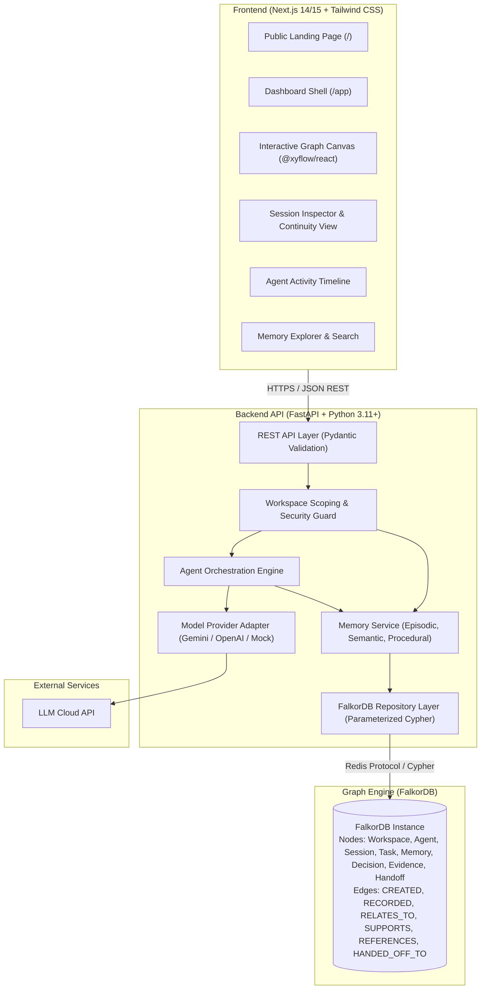
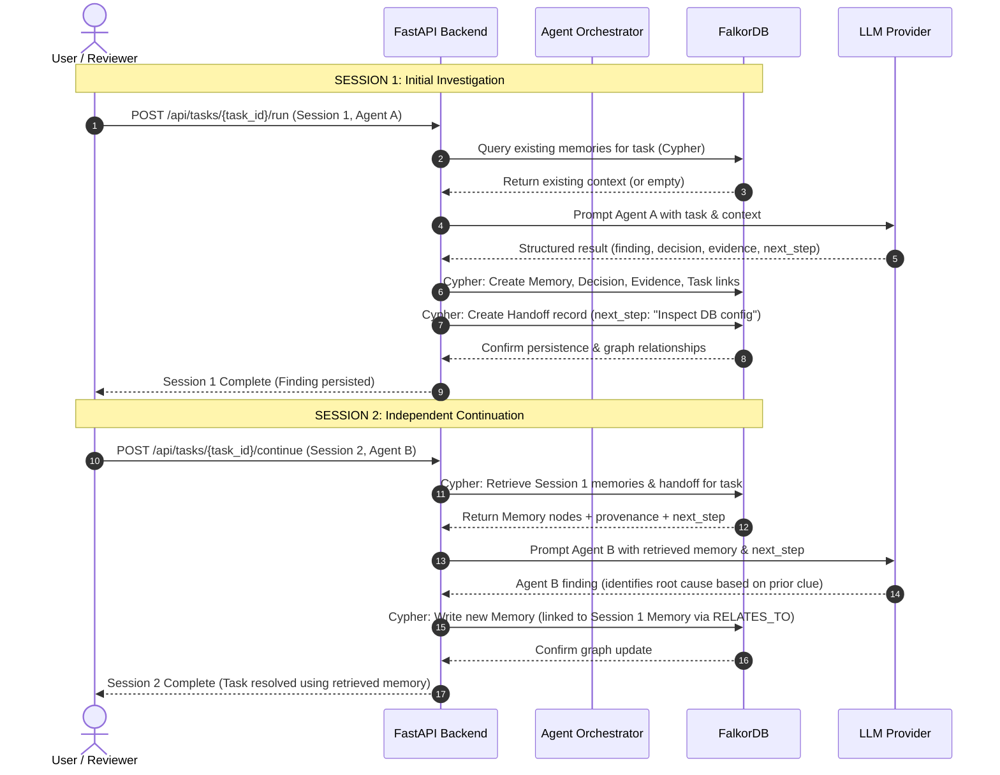

# ContinuumAI — System Architecture Document

> **Status:** Pre-build architectural blueprint  
> **Source of Truth:** Aligned with [`PRD.md`](file:///c:/Users/Hala/Downloads/Project%20Files/ContinuumAI/PRD.md) and [`design.md`](file:///c:/Users/Hala/Downloads/Project%20Files/ContinuumAI/design.md).  
> **Hackathon Track:** WeMakeDevs × FalkorDB — Track 2: Agent Memory and Coordination

---

## 1. Architectural Principles

1. **FalkorDB as the Load-Bearing Core:** The knowledge graph is the primary operational state store. Memories, sessions, agents, tasks, and handoffs are modeled as first-class graph entities rather than flattened relational records.
2. **Explicit Provenance:** Every memory written to the graph must link to its author agent (`Agent`), originating session (`Session`), and relevant task (`Task`).
3. **Strict Tenant & Workspace Isolation:** All Cypher queries must be scoped by `workspace_id`. Cross-workspace reads or writes are strictly prohibited.
4. **Resilient Failure Handling:** If the database or model API fails, the backend must surface a clear error without falsely reporting successful persistence.
5. **No Synthetic Hallucinations:** When no relevant memory exists in the graph, the system explicitly returns "no context found" rather than inventing background facts.

---

## 2. Component Responsibilities



### 2.1 Frontend (Next.js + TypeScript)
- **Role:** Presents the public product landing page and interactive application dashboard.
- **Visual Identity:** 21st.dev stencil-grid aesthetic (`Oxanium` display headings, `IBM Plex Mono` labels, `#FF681F` orange accents, near-black `#111111` backdrop).
- **Graph Visualizer:** Uses React Flow (`@xyflow/react`) to render real nodes and edges retrieved from the FalkorDB repository.
- **Isolation Constraint:** Never holds database credentials or directly executes Cypher queries.

### 2.2 Backend API (FastAPI)
- **Role:** Handles validation, business logic, agent orchestration, and graph data access.
- **Workspace Security Guard:** Enforces `workspace_id` validation on every incoming request.
- **Pydantic Schemas:** Enforces strict typing for memory creation, agent execution results, and graph responses.

### 2.3 Agent Orchestration Engine
- Manages the lifecycle of two core agent roles:
  - **Agent A (Investigator / Producer):** In Session 1, queries prior memory, executes bounded work, produces findings, decisions, evidence, and an unfinished next step, then saves this to FalkorDB.
  - **Agent B (Continuation / Consumer):** In Session 2, queries FalkorDB for memories linked to the task, reads Agent A's context, executes the next action, and writes a linked continuation finding back to the graph.

### 2.4 FalkorDB Repository Layer
- Executes parameterized Cypher queries via the official `falkordb` Python client.
- Excludes secrets and raw string interpolation to eliminate Cypher injection risks.

---

## 3. Request Flow & Memory Lifecycle

### 3.1 Signature Workflow: Session 1 → Session 2 Continuity



---

## 4. Agent Handoff Lifecycle

When a session finishes with unfinished work:
1. **Creation:** A `Handoff` entity is recorded in FalkorDB with attributes:
   - `task_id`: Task being handed off
   - `source_agent_id`: Agent completing the initial phase
   - `summary`: High-level synopsis of discoveries
   - `next_action`: Concrete, actionable directive for the successor agent
   - `created_at`: ISO timestamp
2. **Persistence:** The handoff is linked via `(Agent)-[:HANDED_OFF_TO]->(Agent)` and `(Session)-[:RECORDED]->(Handoff)`.
3. **Retrieval:** The successor session queries open handoffs for the task and immediately initiates the next action without re-evaluating completed steps.

---

## 5. Security & Isolation Architecture

### 5.1 Workspace Scoping
Every graph query includes an explicit workspace anchor:
```cypher
MATCH (w:Workspace {id: $workspace_id})-[:HAS_TASK]->(t:Task {id: $task_id})
MATCH (t)-[:HAS_MEMORY]->(m:Memory)
RETURN m, t
```
Cross-workspace queries fail at the Cypher filter level because no relationships exist between different `Workspace` subgraphs.

### 5.2 Secret Management
- Database passwords and API keys are stored exclusively in backend environment variables.
- The Next.js client only receives public metadata and anonymized workspace identifiers.

---

## 6. Architectural Decisions & Open Questions

| Decision | Choice | Rationale |
| :--- | :--- | :--- |
| **Graph Database** | FalkorDB | Mandatory hackathon requirement; low-latency graph queries via Cypher. |
| **Frontend Framework** | Next.js (App Router) | High performance, static rendering for landing page, dynamic client components for React Flow graph. |
| **Graph Visualizer** | React Flow (`@xyflow/react`) | Industry-standard, highly customizable node rendering, robust pan/zoom support. |
| **Backend Framework** | FastAPI (Python) | Native support for official `falkordb` Python SDK and Pydantic data modeling. |
| **Deterministic Mode** | Built-in fallback runner | Ensures the demo can run reliably during evaluation even if external LLM API rate limits are hit. |

### Open Questions to Resolve During Hackathon
1. **FalkorDB Deployment:** Cloud free tier vs. local Docker container (will support both via `.env` configuration).
2. **Procedural Memory Node Representation:** Should procedures be stored as distinct `:Procedure` nodes or as `:Memory` nodes with `memory_type: "procedural"`? (Recommended: unified `:Memory` label with a `memory_type` property for query simplicity).
