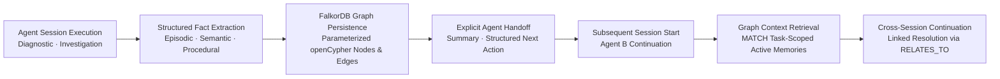
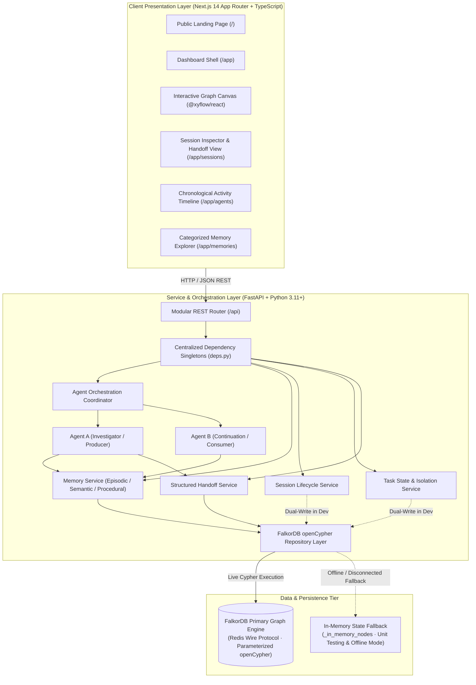

# ContinuumAI — Persistent Memory & Multi-Agent Coordination

<p align="center">
  
  
  
  
  
</p>

<p align="center">
  <strong>Give AI agents continuity across sessions.</strong><br />
  A graph-powered memory and coordination layer structuring agent experiences, operational findings, task states, and multi-agent handoffs into a persistent knowledge graph.
</p>

<p align="center">
  <a href="https://github.com/Halanaaz1401/ContinuumAI">📦 GitHub Repository</a> •
  <a href="#-system-architecture">🏗️ Architecture</a> •
  <a href="#-graph-data-model">🕸️ Graph Model</a> •
  <a href="#-installation--quickstart">🚀 Quickstart</a> •
  <a href="#-table-of-contents">📖 Documentation</a>
</p>

<p align="center">
  <strong>Engineered by Hala Naaz</strong>
</p>

---

## Technology Stack

<p align="center">
  
  
  
  
  
  
  
  
  
  
  
  
  
  
</p>

### Stack at a Glance

| Architectural Layer | Core Technologies | Primary Operational Purpose |
| :--- | :--- | :--- |
| **Frontend Framework** | Next.js 14.2 (App Router), React 18.3, TypeScript 5.4 | Server & client UI rendering, typed REST consumers, responsive workspace shells |
| **Graph Observability** | React Flow (`@xyflow/react` v12), Lucide React | Interactive node-and-edge visualizer mapping real-time agent memory networks |
| **Design & UI System** | Tailwind CSS 3.4, PostCSS, IBM Plex Mono & Oxanium | Technical stencil-grid aesthetic, high-contrast dark theme, accessible status badges |
| **Backend API Engine** | Python 3.11+, FastAPI 0.110+, Uvicorn (ASGI) | High-throughput async REST endpoints, request validation, dependency singletons |
| **Data Modeling & Validation** | Pydantic v2.6, Pydantic Settings | Strict schema enforcement for memory nodes, handoffs, sessions, and environment config |
| **Primary Graph Database** | FalkorDB (via official `falkordb` Python client) | Low-latency graph engine executing parameterized openCypher statements |
| **Protocol Transport** | Redis Protocol (`redis-py` v8+) | High-performance wire protocol connecting FastAPI services to FalkorDB |
| **Memory Fallback Store** | In-Memory Python State Dictionaries | Resilient fallback ensuring unit tests and offline demos execute without a live DB |
| **Testing & Quality Assurance** | Pytest 8.0+, pytest-asyncio, HTTPX, TypeScript `tsc` | Automated test runner verifying workspace isolation, dependency singletons, and route contracts |
| **Containerization** | Docker, Docker Compose (v3.8) | Multi-service orchestration configuring FalkorDB, backend, and frontend containers |

---
## 📖 Table of Contents

- [Project Identity & Overview](#-project-identity--overview)
- [Operational Problem & Solution](#-operational-problem--solution)
  - [The Operational Problem](#the-operational-problem)
  - [The ContinuumAI Solution](#the-continuumai-solution)
  - [Target Personas & Agent Roles](#target-personas--agent-roles)
- [Key Features & Implementation Status](#-key-features--implementation-status)
  - [1. Workspace Multi-Tenant Scoping & Isolation](#1-workspace-multi-tenant-scoping--isolation)
  - [2. Provenance-Linked Memory Creation](#2-provenance-linked-memory-creation)
  - [3. Structured Agent Handoff Contracts](#3-structured-agent-handoff-contracts)
  - [4. Cross-Session Task Context Retrieval](#4-cross-session-task-context-retrieval)
  - [5. Interactive Graph Visualizer & Topology Canvas](#5-interactive-graph-visualizer--topology-canvas)
  - [6. Observable Chronological Activity Timeline](#6-observable-chronological-activity-timeline)
  - [7. Centralized Dependency Injection Architecture](#7-centralized-dependency-injection-architecture)
  - [8. Parameterized openCypher Repository Layer](#8-parameterized-opencypher-repository-layer)
- [Comprehensive Feature Matrix](#-comprehensive-feature-matrix)
- [Signature Workflow: Cross-Session Continuity](#-signature-workflow-cross-session-continuity)
- [System Architecture & Data Flow](#-system-architecture--data-flow)
- [Graph Data Model & Node Entities](#-graph-data-model--node-entities)
- [Verified Cypher Queries & Relationships](#-verified-cypher-queries--relationships)
- [Project Directory Structure](#-project-directory-structure)
- [Installation & Quickstart Guide](#-installation--quickstart-guide)
  - [Prerequisites](#prerequisites)
  - [Local Development Setup](#local-development-setup)
  - [Docker Compose Deployment](#docker-compose-deployment)
- [Environment Variables Reference](#-environment-variables-reference)
- [Running the Services](#-running-the-services)
  - [Starting FastAPI Backend](#starting-fastapi-backend)
  - [Starting Next.js Frontend](#starting-nextjs-frontend)
- [Testing & Quality Assurance](#-testing--quality-assurance)
- [FalkorDB Configuration & Dual-Path Storage](#-falkordb-configuration--dual-path-storage)
- [Current Limitations & Known Issues](#-current-limitations--known-issues)
- [Development Roadmap](#-development-roadmap)
- [Security, Privacy & Safe Operation](#-security-privacy--safe-operation)
- [Contributing Guidelines](#-contributing-guidelines)
- [License](#-license)
- [Author & Maintainer](#-author--maintainer)

---


## 🎯 Project Identity & Overview

**ContinuumAI** is an open-source, high-performance graph memory and state coordination layer engineered to give autonomous AI agents persistent, cross-session continuity.

In multi-agent environments, autonomous workflows break down because agents operate in ephemeral, stateless silos. ContinuumAI changes this paradigm by transforming transient conversational executions into an observable, persistent knowledge graph:

1. **Persistent Operational Graph**: Replaces ephemeral flat conversation logs with structured graph entities (`Workspace`, `Agent`, `Session`, `Task`, `Memory`, `Handoff`).
2. **Context-Aware Cross-Session Recovery**: When an agent session terminates, the next agent queries the graph to recover prior findings, architectural decisions, and diagnostic telemetry without redundant execution.
3. **Formal Handoff Contracts**: Eliminates prompt-based handoff ambiguity by encapsulating the findings summary, affected entities, and explicit next actions into immutable handoff nodes.
4. **Graph-Native Provenance**: Retains complete traceability for every memory, establishing exactly which agent authored the insight, in which session, for which task, and at what timestamp.
5. **Multi-Tenant Workspace Isolation**: Strictly scopes all Cypher read and write operations by `workspace_id`, preventing cross-tenant context leakage across autonomous pipelines.

---

## ⚠️ Operational Problem & Solution

### The Operational Problem

Autonomous multi-agent systems and LLM pipelines face severe architectural challenges when coordinating on complex, multi-step tasks:

* **Session Discontinuity & Amnesia**: When an agent completes its turn or an API process terminates, its working memory and context window disappear. Successive runs or downstream agents must restart investigations from ground zero.
* **Redundant Diagnostic & API Loops**: Agents repeatedly make the same network requests, database scans, or log analyses because past discoveries are not indexed as queryable knowledge.
* **Fragmented & Unstructured Context**: Important facts, system parameters, and intermediate decisions remain buried in flat text transcripts, making precision retrieval mathematically impossible for future sessions.
* **Fragile & Unstructured Handoffs**: When an investigation transitions from a triage agent to an execution agent, instructions are passed as ambiguous natural language strings without structured parameters or verifiable state.
* **Absence of Provenance & Auditability**: Teams cannot verify why an agent reached a conclusion or trace which prior session or evidence triggered a downstream automated action.

### The ContinuumAI Solution

ContinuumAI implements a closed-loop graph memory pipeline connecting transient agent sessions to persistent graph storage:



### Target Personas & Agent Roles

* **Investigator / Producer Agent (Agent A)**: Receives fresh tasks, conducts initial investigation, records episodic findings into the graph, and crafts structured handoffs with concrete next actions.
* **Continuation / Consumer Agent (Agent B)**: Initializes in independent, clean sessions, queries FalkorDB for active memories linked to the task, consumes prior findings, executes remediation, and links new semantic knowledge to prior nodes.
* **Platform Engineers & AI System Architects**: Configure workspace boundaries, monitor persistent agent interactions, and audit cross-agent handoff contracts.
* **Human-in-the-Loop Operators**: Inspect real-time React Flow visual topologies, review agent activity timelines, and trace memory provenance before approving automated remediations.

---


## 🚀 Key Features & Implementation Status

### 1. Workspace Multi-Tenant Scoping & Isolation

Strict workspace scoping guarantees that memories, tasks, sessions, and agents remain entirely partitioned within their tenant boundary. All repository reads, writes, and deletions require a validated `workspace_id`.

* **What it does**: Enforces boundary checks on all REST endpoints and injects `$workspace_id` parameters into every openCypher query.
* **Why it is useful**: Prevents data leakage between separate autonomous agent teams, customer projects, or staging environments.
* **Components**: [backend/app/api/deps.py](file:///c:/Users/Hala/Downloads/Project%20Files/ContinuumAI/backend/app/api/deps.py), [backend/app/services/task_service.py](file:///c:/Users/Hala/Downloads/Project%20Files/ContinuumAI/backend/app/services/task_service.py), and [backend/app/graph/repository.py](file:///c:/Users/Hala/Downloads/Project%20Files/ContinuumAI/backend/app/graph/repository.py)
* **API Endpoints**: `GET /api/workspaces/current`, `POST /api/workspaces/reset`
* **Status**: **Implemented & Tested (In-Memory)**

---

### 2. Provenance-Linked Memory Creation

Captures operational findings with rich, structured metadata categorized into **Episodic** (runtime incidents), **Semantic** (discovered system topology), or **Procedural** (diagnostic recipes) types.

* **What it does**: Generates unique memory nodes connected to authoring agent, originating session, and parent task with ISO-8601 timestamps.
* **Why it is useful**: Eliminates hallucinated facts by providing a verifiable audit trail explaining when and how an insight was discovered.
* **Components**: [backend/app/services/memory_service.py](file:///c:/Users/Hala/Downloads/Project%20Files/ContinuumAI/backend/app/services/memory_service.py) and [backend/app/models/memory.py](file:///c:/Users/Hala/Downloads/Project%20Files/ContinuumAI/backend/app/models/memory.py)
* **API Endpoints**: `POST /api/memories`, `GET /api/memories`, `GET /api/memories?task_id={id}`
* **Status**: **Implemented & Tested**

---

### 3. Structured Agent Handoff Contracts

Formalized coordination contracts allowing agents to pass work across session boundaries without ambiguous conversational prompts.

* **What it does**: Persists an explicit `Handoff` node encapsulating findings summary, affected target agent, and the concrete next action.
* **Why it is useful**: Enables asynchronous work handoffs where subsequent agents immediately know the exact action to execute.
* **Components**: [backend/app/services/handoff_service.py](file:///c:/Users/Hala/Downloads/Project%20Files/ContinuumAI/backend/app/services/handoff_service.py) and [backend/app/agents/agent_a.py](file:///c:/Users/Hala/Downloads/Project%20Files/ContinuumAI/backend/app/agents/agent_a.py)
* **API Endpoints**: `GET /api/handoffs`
* **Status**: **Implemented & Tested**

---

### 4. Cross-Session Task Context Retrieval

Enables continuation agents in fresh sessions to recover relevant historical findings linked to an ongoing task without redundant diagnostic execution.

* **What it does**: Queries the graph for active memories associated with a target `task_id` and orders them chronologically for injection into agent context.
* **Why it is useful**: Allows Agent B to continue an investigation initiated by Agent A, resolving tasks faster and saving significant LLM token costs.
* **Components**: [backend/app/agents/agent_b.py](file:///c:/Users/Hala/Downloads/Project%20Files/ContinuumAI/backend/app/agents/agent_b.py) and [backend/app/agents/orchestrator.py](file:///c:/Users/Hala/Downloads/Project%20Files/ContinuumAI/backend/app/agents/orchestrator.py)
* **API Endpoints**: `POST /api/tasks/{task_id}/run`
* **Status**: **Implemented & Tested (In-Memory)**

---

### 5. Interactive Graph Visualizer & Topology Canvas

A visual graph inspection canvas built with React Flow (`@xyflow/react`) that maps relationships between workspaces, tasks, sessions, agents, and memories.

* **What it does**: Renders graph topology with customized nodes, animated relationship edges (`RELATES_TO`), and a details drawer for deep inspection.
* **Why it is useful**: Gives operators intuitive visibility into agent reasoning, memory connections, and handoff chains.
* **Components**: [frontend/app/app/graph/page.tsx](file:///c:/Users/Hala/Downloads/Project%20Files/ContinuumAI/frontend/app/app/graph/page.tsx) and [frontend/components/graph/graph-canvas.tsx](file:///c:/Users/Hala/Downloads/Project%20Files/ContinuumAI/frontend/components/graph/graph-canvas.tsx)
* **API Endpoints**: `GET /api/graph`
* **Status**: **Implemented (Frontend Verified; Backend Serialization uses In-Memory Map)**

---

### 6. Observable Chronological Activity Timeline

Real-time audit log tracking every agent transition, task assignment, memory write, context retrieval, and handoff event.

* **What it does**: Collects structured `AgentEvent` objects during task execution and exposes them in chronological order.
* **Why it is useful**: Provides an operational trail for debugging multi-agent coordination issues and verifying compliance.
* **Components**: [frontend/app/app/agents/page.tsx](file:///c:/Users/Hala/Downloads/Project%20Files/ContinuumAI/frontend/app/app/agents/page.tsx) and [frontend/components/agents/timeline.tsx](file:///c:/Users/Hala/Downloads/Project%20Files/ContinuumAI/frontend/components/agents/timeline.tsx)
* **API Endpoints**: `GET /api/agents/events`, `GET /api/agents`
* **Status**: **Implemented & Verified**

---

### 7. Centralized Dependency Injection Architecture

Robust FastAPI dependency injection providers configured in `deps.py` that manage shared singletons across all API routers.

* **What it does**: Guarantees that `SessionService`, `TaskService`, `MemoryService`, `HandoffService`, and `AgentOrchestrator` share consistent state across distinct route modules.
* **Why it is useful**: Prevents state fragmentation across REST routes and enables clean singleton resetting during automated test teardowns.
* **Components**: [backend/app/api/deps.py](file:///c:/Users/Hala/Downloads/Project%20Files/ContinuumAI/backend/app/api/deps.py)
* **Status**: **Implemented & Unit-Tested**

---

### 8. Parameterized openCypher Repository Layer

Dedicated graph query repository utilizing strictly parameterized Cypher statements with dictionary bindings.

* **What it does**: Pre-defines indexes, constraint statements, entity creations (`MERGE`, `CREATE`), and relationship traversals (`RELATES_TO`, `RECORDED`, `HAS_MEMORY`).
* **Why it is useful**: Mitigates Cypher injection risks, prevents parsing overhead on the graph database, and formalizes graph schema contracts.
* **Components**: [backend/app/graph/queries.py](file:///c:/Users/Hala/Downloads/Project%20Files/ContinuumAI/backend/app/graph/queries.py) and [backend/app/graph/repository.py](file:///c:/Users/Hala/Downloads/Project%20Files/ContinuumAI/backend/app/graph/repository.py)
* **Status**: **Implemented (Awaiting Live Database Dual-Write Binding)**

---

## 📊 Comprehensive Feature Matrix

| Feature | Operational Capability | Implementation Status | Audit & Verification Evidence |
| :--- | :--- | :--- | :--- |
| **Workspace Tenant Scoping** | Parameterized workspace boundaries across all queries | **Implemented & Tested** | Verified by `test_isolation.py` and `test_deps_and_cross_routes.py`. |
| **Dependency Singletons** | Centralized dependency providers in FastAPI | **Implemented & Tested** | Verified by `test_dependency_singletons` in Pytest suite. |
| **Cross-Route State Sharing** | Shared task and session visibility across REST endpoints | **Implemented & Tested** | Verified by `test_cross_route_session_and_task_visibility`. |
| **Episodic Memory Creation** | Storing discrete event findings with agent provenance | **Implemented & Tested** | Unit-tested via `MemoryService.create_memory()`. |
| **Cross-Session Retrieval** | Agent B recovering Agent A context across sessions | **Implemented & Tested** | Verified in `test_orchestrator.py` (in-memory mode). |
| **Knowledge Continuation** | Linking new findings to prior nodes via `RELATES_TO` | **Implemented & Tested** | Verified by `link_memory_continuation()` in `repository.py`. |
| **Structured Handoff Contracts** | Explicit next actions and summary entities | **Implemented & Tested** | Verified via `HandoffService.create_handoff()`. |
| **Interactive Graph Visualizer** | React Flow visual canvas with details drawer | **Implemented** | Verified via `tsc --noEmit` and frontend component rendering. |
| **Activity Timeline** | Chronological audit log of agent events | **Implemented** | Verified via `/api/agents/events` and Next.js timeline view. |
| **Parameterized Cypher Schema** | Centralized openCypher queries with dictionary params | **Implemented** | Formally defined in `queries.py` with zero string concatenation. |
| **Live FalkorDB Persistence** | Dual-write persistence directly to remote graph engine | **Partially Implemented** | Connection wrapper active; live persistence unverified; fallback active. |
| **Evidence & Decision Nodes** | First-class entities for logs and architectural choices | **Planned** | Schema documented in `PRD.md`; pending graph integration. |
| **Live LLM Model Adapters** | Dynamic prompt synthesis with Gemini / OpenAI | **Planned** | Deterministic mock runner active; live provider binding planned. |

---


## 🔄 Signature Workflow: Cross-Session Continuity

The primary coordination workflow demonstrates how two autonomous agents preserve, transfer, and consume knowledge across disconnected execution sessions:

```mermaid
sequenceDiagram
    autonumber
    actor User as Operator
    participant API as FastAPI Backend
    participant Orch as Agent Orchestrator
    participant Repo as Graph Repository
    participant DB as FalkorDB Engine

    Note over User, DB: SESSION 1: Initial Triage & Investigation (Agent A)
    User->>API: POST /api/tasks/{task_id}/run (Session 1, Role: Investigator)
    API->>Orch: execute_task(task_id, Session 1, Agent A)
    Orch->>Repo: retrieve_memories_for_task(workspace_id, task_id)
    Repo-->>Orch: 0 prior memories discovered (Cold Start)
    Orch->>Orch: Agent A executes diagnostic investigation
    Note over Orch: Finding: Connection pool exhausted (10/10 limit reached under 500 RPS)
    Orch->>Repo: create_memory(Episodic: "Connection pool exhausted (10/10 limit)")
    Repo->>DB: Cypher: CREATE (m:Memory) -[:CREATED]-(AgentA), -[:RECORDED]-(Session1)
    Orch->>Repo: create_handoff("Increase max_connections to 50 in pool config")
    Repo->>DB: Cypher: CREATE (h:Handoff) -[:HAS_HANDOFF]-(Task)
    Orch->>API: Mark Session 1 Completed & Record Timeline Event
    API-->>User: Investigation Completed, Findings & Handoff Stored

    Note over User, DB: SESSION 2: Context Recovery & Continuation (Agent B)
    User->>API: POST /api/tasks/{task_id}/run (Session 2, Role: Continuation)
    API->>Orch: execute_task(task_id, Session 2, Agent B)
    Orch->>Repo: retrieve_memories_for_task(workspace_id, task_id)
    Repo-->>Orch: Return Session 1 Memory ("Connection pool exhausted (10/10 limit)")
    Orch->>Orch: Agent B reads Session 1 context & executes next action
    Note over Orch: Action: Increased pool to 50; under 500 RPS p99 latency dropped to 42ms
    Orch->>Repo: create_memory(Semantic: "Pool resized to 50, throughput stable")
    Repo->>DB: Cypher: CREATE (NewMem:Memory)
    Orch->>Repo: link_memory_continuation(NewMem.id, PriorMem.id)
    Repo->>DB: Cypher: CREATE (NewMem)-[:RELATES_TO {rel: 'continues_investigation'}]->(PriorMem)
    Orch->>API: Mark Session 2 Completed & Update Task Status to 'resolved'
    API-->>User: Task Successfully Resolved with Graph Traceability
```

### Operational Lifecycle Breakdown

1. **Task Assignment & Cold Check (Session 1)**: Agent A is assigned task `task-01` in clean session `sess-01`. It queries the repository for historical context; zero memories are found, confirming an initial cold investigation.
2. **Diagnostic Execution**: Agent A conducts bounded diagnostic analysis, discovering HTTP 504 gateway timeouts caused by connection pool exhaustion under 500 RPS load.
3. **Episodic Memory Graph Commit**: Agent A stores an `EPISODIC` memory entity linked to author `agent-a-investigator`, session `sess-01`, and task `task-01`.
4. **Structured Handoff Creation**: Agent A creates an explicit `Handoff` record specifying the target role (`agent-b-continuation`), findings summary, and the concrete next action: *"Increase max_connections to 50 in pool configuration and verify throughput."*
5. **Session 1 Termination**: Session 1 completes, recording its end timestamp and memory associations. Its in-memory execution process ends.
6. **Session 2 Initialization**: An independent session `sess-02` begins with Agent B. Agent B has no internal conversational context from Session 1.
7. **Task-Scoped Graph Recovery**: Agent B executes `retrieve_memories_for_task()` via openCypher, immediately recovering Agent A's findings and next action without re-running diagnostics.
8. **Continuation & Relationship Linking**: Agent B executes the remediation, verifies latency reduction, saves a `SEMANTIC` memory, and executes `link_memory_continuation()` to create a directional `RELATES_TO` edge in the graph. The task status updates to `resolved`.

---

## 🏗️ System Architecture & Data Flow

ContinuumAI is architected around a decoupled three-tier design: a typed Next.js 14 client, an asynchronous FastAPI service layer with centralized dependency singletons, and a dual-path graph persistence tier.



### Architectural Subsystems

1. **Client Presentation Tier (Next.js 14)**: Built with React 18 and Tailwind CSS, featuring an interactive `@xyflow/react` graph canvas rendering real-time nodes and edges. The client communicates exclusively through standard JSON REST endpoints without executing Cypher directly.
2. **Service & Orchestration Tier (FastAPI)**: Routes requests through `deps.py` dependency singletons, guaranteeing shared state across endpoints. The orchestrator coordinates deterministic or live agent workflows across separate sessions.
3. **Persistence Tier (FalkorDB & Fallback)**: The graph repository translates domain events into parameterized Cypher statements. If a live database connection is unavailable, it gracefully routes into an in-memory dictionary store, allowing local test suites to execute reliably.

---

## 🕸️ Graph Data Model & Node Entities

ContinuumAI models multi-agent state, telemetry, and workflow provenance as a connected property graph. Rather than treating agent turns as flat text logs, discrete entities are maintained as strongly typed nodes connected by directed, semantic edges:

```text
       ┌────────────────┐
       │   Workspace    │
       └───┬────┬────┬──┘
           │    │    │
           │    │    └────────[:HAS_TASK]────────┐
           │    │                                │
  [:HAS_AGENT] [:HAS_SESSION]                    ▼
           │    │                           ┌─────────┐
           │    │      ┌───[:HAS_MEMORY]────┤  Task   │
           ▼    ▼      │                    └───┬─────┘
       ┌───────────┐   │                        │
       │   Agent   │   │                 [:HAS_HANDOFF]
       └─────┬─────┘   │                        │
             │         │                        ▼
      [:PARTICIPATED_IN]                      ┌─────────┐
             │         │                      │ Handoff │
             ▼         │                      └────▲────┘
       ┌───────────┐   │                           │
       │  Session  │   │                     [:RECORDED]
       └─────┬─────┘   │                           │
             │         ▼                           │
        [:RECORDED]►┌────────┐                     │
             │      │ Memory │◄────[:CREATED]──────┘ (Agent)
             │      └───▲────┘
             │          │ [:RELATES_TO {relationship: 'continues_investigation'}]
             └──────────┴──────────────────────────┘
```

### Graph Node Entities

| Entity Label | Node ID Format | Key Properties | Role & Persistence Status |
| :--- | :--- | :--- | :--- |
| **`Workspace`** | `ws:{workspace_id}` | `id`, `name`, `created_at` | Top-level tenant container ensuring multi-tenant isolation. **Implemented & Verified** in both FalkorDB (`MERGE_WORKSPACE`) and in-memory store. |
| **`Agent`** | `agent_{role}` | `id`, `role`, `status`, `workspace_id` | Autonomous agent identity representing producers (investigators) and consumers (continuators). **Implemented in Memory Service**; Cypher query `MERGE_AGENT` defined. |
| **`Session`** | `session_{uuid}` | `id`, `workspace_id`, `status`, `started_at`, `ended_at` | Bounded execution turn tracking agent activity duration and state. **Managed by SessionService**; Cypher query `CREATE_SESSION` defined. |
| **`Task`** | `task_{uuid}` | `id`, `workspace_id`, `title`, `context`, `status`, `created_at` | Unit of work or incident ticket being investigated. **Managed by TaskService**; Cypher query `CREATE_TASK` defined. |
| **`Memory`** | `mem_{uuid}` | `id`, `workspace_id`, `memory_type`, `content`, `summary`, `source_agent_id`, `source_session_id`, `task_id`, `status`, `created_at` | Core knowledge atom (`episodic`, `semantic`, or `procedural`). **Fully Implemented** in FalkorDB (`CREATE_MEMORY`) and in-memory repository. |
| **`Handoff`** | `handoff_{uuid}` | `id`, `workspace_id`, `source_agent_id`, `session_id`, `task_id`, `summary`, `next_action`, `created_at` | Structured coordination contract passing context to subsequent sessions. **Fully Implemented** in FalkorDB (`CREATE_HANDOFF`) and in-memory repository. |
| **`Decision`** | *Planned* | `id`, `workspace_id`, `rationale`, `selected_action`, `timestamp` | *Roadmap Entity*: Structured architectural or remediation choice made by an agent. |
| **`Evidence`** | *Planned* | `id`, `workspace_id`, `payload`, `mime_type`, `source_url` | *Roadmap Entity*: Raw log snippet, stack trace, or metric payload supporting a memory. |

---

### Graph Relationship Edges

| Relationship Type | Source Node | Target Node | Cardinality | Semantics & Provenance Role |
| :--- | :--- | :--- | :--- | :--- |
| **`[:HAS_AGENT]`** | `Workspace` | `Agent` | `1 : N` | Binds autonomous agents to a specific workspace tenant. |
| **`[:HAS_SESSION]`** | `Workspace` | `Session` | `1 : N` | Tracks all execution sessions launched within a workspace. |
| **`[:PARTICIPATED_IN]`** | `Agent` | `Session` | `1 : N` | Maps which agent was active during a bounded session. |
| **`[:HAS_TASK]`** | `Workspace` | `Task` | `1 : N` | Scopes tasks and incident investigations to the workspace. |
| **`[:HAS_MEMORY]`** | `Task` | `Memory` | `1 : N` | Connects findings and observations directly to the incident being solved. |
| **`[:CREATED]`** | `Agent` | `Memory` | `1 : N` | Establishes authorial provenance for every recorded memory atom. |
| **`[:RECORDED]`** | `Session` | `Memory` | `1 : N` | Identifies the exact session in which a memory was generated. |
| **`[:HAS_HANDOFF]`** | `Task` | `Handoff` | `1 : N` | Attaches formal handoff transitions to the originating task. |
| **`[:RECORDED]`** | `Session` | `Handoff` | `1 : N` | Tracks which session produced the handoff contract. |
| **`[:RELATES_TO]`** | `Memory` | `Memory` | `N : M` | Directional knowledge link connecting a new finding to a prior insight with property `{relationship: 'continues_investigation'}`. |

---

## ⚡ Verified Cypher Queries & Relationships

All graph interactions are centralized in `backend/app/graph/queries.py` and executed via `backend/app/graph/repository.py` using strictly parameterized openCypher statements:

### 1. Schema Constraints & Performance Indexes
```cypher
CREATE INDEX FOR (w:Workspace) ON (w.id);
CREATE INDEX FOR (m:Memory) ON (m.id);
CREATE INDEX FOR (t:Task) ON (t.id);
CREATE INDEX FOR (s:Session) ON (s.id);
CREATE INDEX FOR (a:Agent) ON (a.id);
```

### 2. Workspace Provisioning & Multi-Tenant Scoping
```cypher
MERGE (w:Workspace {id: $workspace_id})
ON CREATE SET w.name = $name, w.created_at = $created_at
RETURN w.id AS id, w.name AS name;
```

### 3. Provenance-Linked Memory Ingestion
```cypher
MATCH (w:Workspace {id: $workspace_id})
MATCH (a:Agent {id: $agent_id})
MATCH (s:Session {id: $session_id})
MATCH (t:Task {id: $task_id})
CREATE (m:Memory {
    id: $memory_id,
    workspace_id: $workspace_id,
    memory_type: $memory_type,
    content: $content,
    summary: $summary,
    source_agent_id: $agent_id,
    source_session_id: $session_id,
    status: 'active',
    created_at: $created_at
})
CREATE (a)-[:CREATED]->(m)
CREATE (s)-[:RECORDED]->(m)
CREATE (t)-[:HAS_MEMORY]->(m)
RETURN m.id AS id;
```

### 4. Cross-Session Task Context Retrieval
```cypher
MATCH (w:Workspace {id: $workspace_id})-[:HAS_TASK]->(t:Task {id: $task_id})
MATCH (t)-[:HAS_MEMORY]->(m:Memory {status: 'active'})
RETURN m.id AS id,
       m.workspace_id AS workspace_id,
       m.memory_type AS memory_type,
       m.content AS content,
       m.summary AS summary,
       m.source_agent_id AS source_agent_id,
       m.source_session_id AS source_session_id,
       m.created_at AS created_at
ORDER BY m.created_at ASC;
```

### 5. Semantic Memory Continuation Linking
```cypher
MATCH (prior:Memory {id: $prior_memory_id})
MATCH (newMem:Memory {id: $new_memory_id})
CREATE (newMem)-[:RELATES_TO {relationship: 'continues_investigation'}]->(prior)
RETURN newMem.id AS source, prior.id AS target;
```

### 6. Formal Agent Handoff Contract Creation
```cypher
MATCH (src:Agent {id: $source_agent_id})
MATCH (s:Session {id: $session_id})
MATCH (t:Task {id: $task_id})
CREATE (h:Handoff {
    id: $handoff_id,
    workspace_id: $workspace_id,
    summary: $summary,
    next_action: $next_action,
    created_at: $created_at
})
CREATE (s)-[:RECORDED]->(h)
CREATE (t)-[:HAS_HANDOFF]->(h)
RETURN h.id AS id;
```

### 7. Full Workspace Topology Query
```cypher
MATCH (n {workspace_id: $workspace_id})
OPTIONAL MATCH (n)-[r]->(m {workspace_id: $workspace_id})
RETURN n, r, m;
```

> [!IMPORTANT]
> **Architectural Gotcha: Prerequisite Graph Nodes**
> Notice that `CREATE_MEMORY` and `CREATE_HANDOFF` begin with multiple prerequisite `MATCH` clauses (`MATCH (w:Workspace)`, `MATCH (a:Agent)`, `MATCH (s:Session)`, `MATCH (t:Task)`). In openCypher semantics, if *any* of those matched nodes do not already exist in the graph database, the pattern match evaluates to zero rows, and the subsequent `CREATE` clause is never reached.
> In the current codebase, `SessionService` and `TaskService` store state primarily in in-memory dictionaries. When running against live FalkorDB, ensure `MERGE_WORKSPACE`, `MERGE_AGENT`, `CREATE_SESSION`, and `CREATE_TASK` are invoked prior to recording memories, or utilize the repository's resilient in-memory fallback.

---


## 📁 Project Directory Structure

ContinuumAI is organized as a clean full-stack monorepo with explicit separation between backend domain models, graph repository drivers, and Next.js reactive visualization components:

```text
ContinuumAI/
├── .env.example                  # Environment configuration template
├── .gitignore                    # Strict Git exclusions (.env, node_modules, .venv, caches)
├── ARCHITECTURE.md               # Formal architectural specification & subsystem topology
├── design.md                     # Design tokens, color palette, and layout specifications
├── docker-compose.yml            # Multi-service container orchestration (FalkorDB + Backend + Frontend)
├── PRD.md                        # Product requirements document & functional scope
├── README.md                     # Comprehensive open-source documentation
├── TASKS.md                      # Engineering implementation checklist & audit ledger
│
├── backend/                      # High-Performance FastAPI Application
│   ├── Dockerfile                # Production container build definition
│   ├── requirements.txt          # Python dependencies (FastAPI, FalkorDB, Pydantic, Pytest)
│   ├── app/
│   │   ├── main.py               # Application entrypoint, lifespan events, and CORS routing
│   │   ├── agents/               # Multi-agent orchestration engine
│   │   │   ├── agent_a.py        # Investigator/Producer agent (discovers issues, writes memories)
│   │   │   ├── agent_b.py        # Continuation/Consumer agent (retrieves context, resolves tasks)
│   │   │   └── orchestrator.py   # Cross-session pipeline orchestrator & event bus
│   │   ├── api/                  # Modular REST API endpoints
│   │   │   ├── deps.py           # Centralized dependency injection singletons
│   │   │   └── routes.py         # Workspace, memory, session, task, and graph endpoints
│   │   ├── core/                 # Core framework primitives
│   │   │   ├── config.py         # Pydantic Settings configuration parser
│   │   │   └── logging.py        # Structured logging configuration
│   │   ├── graph/                # Graph persistence layer
│   │   │   ├── connection.py     # FalkorDB client driver wrapper with fallback detection
│   │   │   ├── queries.py        # Parameterized openCypher statement catalogue
│   │   │   └── repository.py     # Graph repository with dual-path execution (FalkorDB / In-Memory)
│   │   ├── models/               # Pydantic domain models & schemas
│   │   │   ├── agent.py          # Agent identity & event models
│   │   │   ├── graph.py          # React Flow graph node & edge serialization schemas
│   │   │   ├── memory.py         # Memory creation, query, and response models
│   │   │   ├── session.py        # Session state models
│   │   │   └── task.py           # Task ticket & context models
│   │   └── services/             # Application domain services
│   │       ├── handoff_service.py # Handoff contract management
│   │       ├── memory_service.py  # Memory ingestion, validation, and retrieval
│   │       ├── session_service.py # Session lifecycle management
│   │       └── task_service.py    # Task state and context isolation
│   └── tests/                    # Automated Pytest suite
│       ├── conftest.py           # Pytest fixtures and mock client setup
│       ├── test_falkordb_integration.py # Live FalkorDB connectivity test (auto-skips if offline)
│       ├── test_orchestrator.py  # End-to-end Session 1 → Session 2 continuity test
│       ├── test_workspace_isolation.py  # Multi-tenant partitioning verification
│       └── test_deps_and_cross_routes.py # Dependency singleton & route contract tests
│
├── frontend/                     # Modern Next.js 14 Web Application
│   ├── Dockerfile                # Production container build definition
│   ├── package.json              # Node dependencies (Next.js 14, React 18, @xyflow/react, Lucide)
│   ├── postcss.config.mjs        # PostCSS configuration
│   ├── tailwind.config.ts        # Tailwind styling tokens & design system theme
│   ├── tsconfig.json             # TypeScript compiler settings
│   ├── app/                      # Next.js App Router
│   │   ├── layout.tsx            # Root HTML layout with Google Font typography
│   │   ├── page.tsx              # Public interactive landing page & architecture showcase
│   │   ├── globals.css           # Global CSS variables & glassmorphic utilities
│   │   └── app/                  # Application dashboard
│   │       ├── page.tsx          # Dashboard overview & quick actions
│   │       ├── layout.tsx        # Dashboard sidebar & topbar navigation shell
│   │       ├── agents/page.tsx   # Real-time multi-agent activity timeline
│   │       ├── graph/page.tsx    # Interactive React Flow graph canvas
│   │       ├── memories/page.tsx # Memory explorer & tabular search
│   │       └── tasks/page.tsx    # Task manager & handoff inspector
│   ├── components/               # Modular UI component library
│   │   ├── agents/               # Timeline and agent status cards
│   │   ├── graph/                # React Flow canvas, custom node cards, edge renderers, details drawer
│   │   ├── layout/               # App sidebar, navigation headers, command bars
│   │   ├── memories/             # Memory badges, filter pills, and cards
│   │   └── ui/                   # Button, badge, modal, and drawer primitives
│   └── lib/                      # Frontend utilities & clients
│       ├── api.ts                # Strongly typed REST client for FastAPI endpoints
│       ├── types.ts              # TypeScript interfaces mirroring backend Pydantic schemas
│       └── utils.ts              # CSS class merging and formatting helpers
│
└── docs/                         # In-Depth Engineering Documentation
    ├── api-spec.md               # OpenAPI endpoint contracts & curl examples
    ├── demo-script.md            # Step-by-step reproducible scenario walkthrough
    ├── graph-schema.md           # Cypher data model & indexing reference
    └── local-development.md      # Detailed developer workstation setup guide
```

---

## 🚀 Installation & Quickstart Guide

### Prerequisites

Ensure the following runtimes and utilities are installed on your workstation before proceeding:

* **Python:** Version `3.11`, `3.12`, or `3.13` (Python `3.14` pre-release pure-Python wheels are also supported). Verify with `python --version`.
* **Node.js:** Version `18.x` or `20.x` LTS with `npm`. Verify with `node --version` and `npm --version`.
* **FalkorDB Instance:**
  * **Local:** Docker engine to run `falkordb/falkordb:latest`.
  * **Cloud:** A free instance provisioned on [FalkorDB Cloud](https://app.falkordb.cloud/).
  * *Note: If no database is available, ContinuumAI automatically operates in resilient in-memory fallback mode.*
* **Docker & Docker Compose:** *(Optional)* For zero-configuration containerized deployment.

---

### Local Development Setup

#### 1. Clone the Repository
```bash
git clone https://github.com/Halanaaz1401/ContinuumAI.git
cd ContinuumAI
```

#### 2. Configure Environment Variables
Copy the template file to `.env`:

```bash
# On Linux / macOS
cp .env.example .env

# On Windows PowerShell
Copy-Item .env.example .env
```

Open `.env` in your preferred editor. For local testing without a live FalkorDB instance, the default values operate immediately in fallback mode. To connect to FalkorDB Cloud or a local Docker container, configure the `FALKORDB_*` credentials.

#### 3. Backend Virtual Environment & Dependencies
```bash
# Navigate to backend directory
cd backend

# Create virtual environment
python -m venv .venv

# Activate virtual environment
# On Linux / macOS:
source .venv/bin/activate
# On Windows PowerShell:
.\.venv\Scripts\Activate.ps1

# Upgrade pip and install all backend dependencies
pip install --upgrade pip
pip install -r requirements.txt
```

#### 4. Frontend Dependencies
In a separate terminal:
```bash
# Navigate to frontend directory
cd frontend

# Install Node.js dependencies
npm install
```

---

### Docker Compose Deployment

ContinuumAI includes a production-ready `docker-compose.yml` that provisions FalkorDB, the FastAPI backend, and the Next.js frontend in isolated containers:

```bash
# Build and launch all three services in detached mode
docker compose up --build -d

# View consolidated live container logs
docker compose logs -f

# Shut down all services and retain persistent graph data volume
docker compose down
```

| Service | Container Name | Internal Port | Host Port | Purpose |
| :--- | :--- | :--- | :--- | :--- |
| **`falkordb`** | `continuumai_falkordb` | `6379` | `6379` | Primary FalkorDB Graph Database with persistent `falkordb_data` volume |
| **`backend`** | `continuumai_backend` | `8000` | `8000` | FastAPI application with auto-reloading and graph connectivity |
| **`frontend`** | `continuumai_frontend` | `3000` | `3000` | Next.js 14 App Router dashboard with React Flow canvas |

---

## ⚙️ Environment Variables Reference

ContinuumAI validates all configuration settings at startup using Pydantic Settings (`backend/app/core/config.py`). Values can be provided via `.env` or injected by your container orchestration system:

| Variable Name | Required | Default Value | Description |
| :--- | :---: | :--- | :--- |
| `FALKORDB_HOST` | No | `localhost` | FalkorDB hostname or Cloud endpoint (e.g. `db-xxxx.falkordb.cloud`). |
| `FALKORDB_PORT` | No | `6379` | FalkorDB listening port. |
| `FALKORDB_USERNAME` | No | *(None)* | Username for ACL authentication (typically `default` on FalkorDB Cloud). |
| `FALKORDB_PASSWORD` | No | *(None)* | Password or auth token for database authentication. |
| `FALKORDB_GRAPH_NAME` | No | `continuum_ai` | Primary graph key name within the FalkorDB instance. |
| `LLM_PROVIDER` | No | `mock` | LLM adapter mode: `mock` (deterministic local runner), `gemini`, or `openai`. |
| `LLM_API_KEY` | No | *(None)* | API key for Gemini or OpenAI (required only when `LLM_PROVIDER != mock`). |
| `LLM_MODEL` | No | `gemini-1.5-flash` | Model identifier string when calling external LLM providers. |
| `DEFAULT_WORKSPACE_ID`| No | `demo-workspace-01` | Default tenant workspace identifier used for initialization and testing. |
| `ENVIRONMENT` | No | `development` | Deployment environment tag (`development`, `staging`, `production`). |
| `BACKEND_HOST` | No | `0.0.0.0` | Local network interface binding address for the FastAPI server. |
| `BACKEND_PORT` | No | `8000` | Local listening port for the FastAPI server. |
| `CORS_ORIGINS` | No | `http://localhost:3000,http://127.0.0.1:3000` | Comma-delimited list of allowed cross-origin web origins. |
| `NEXT_PUBLIC_API_BASE_URL` | No | `http://localhost:8000` | Backend API URL used by the client-side Next.js browser bundle. |

> [!CAUTION]
> **Credential Hygiene**
> Never commit `.env` or raw credentials into Git. Verify `.env` is ignored by `.gitignore` before executing commits. Only variables prefixed with `NEXT_PUBLIC_` are exposed to client-side browser JavaScript.

---

## 🏃 Running the Services

### Starting FastAPI Backend

Ensure your Python virtual environment is activated:

```bash
# Navigate to backend directory
cd backend

# Start development server with hot-reload enabled
uvicorn app.main:app --host 0.0.0.0 --port 8000 --reload
```

Once running, verify backend operation:
* **Interactive OpenAPI Swagger UI:** `http://localhost:8000/docs`
* **Alternative ReDoc Documentation:** `http://localhost:8000/redoc`
* **JSON Health Check Endpoint:** `http://localhost:8000/api/health`
* **Current Workspace Status:** `http://localhost:8000/api/workspaces/current`

### Starting Next.js Frontend

In a separate terminal window:

```bash
# Navigate to frontend directory
cd frontend

# Start the Next.js development server
npm run dev
```

Once the development server compiles:
* **Interactive Landing Page:** `http://localhost:3000/`
* **Full Application Dashboard:** `http://localhost:3000/app`
* **Interactive Graph Canvas:** `http://localhost:3000/app/graph`
* **Multi-Agent Timeline:** `http://localhost:3000/app/agents`
* **Memory Knowledge Explorer:** `http://localhost:3000/app/memories`

---

## Running Tests

### Backend Unit & Integration Tests

The test suite validates data models, memory services, workspace isolation, dependency injection, and cross-session orchestration workflows:

```bash
# Run all unit and mock tests from the root directory
pytest backend/tests

# Run specifically with verbose output
pytest -v backend/tests
```

*Note: `backend/tests/test_falkordb_integration.py` requires an active FalkorDB instance and will automatically skip if the host is unreachable.*

### Frontend Type Verification

```bash
cd frontend
npm run type-check
```

---

## FalkorDB Setup & Connection

ContinuumAI is architected to use **FalkorDB** as its primary graph engine.

### Option A: Local Instance via Docker
```bash
docker run -p 6379:6379 -it --rm falkordb/falkordb:latest
```

### Option B: FalkorDB Cloud
1. Create a free instance on [app.falkordb.cloud](https://app.falkordb.cloud/).
2. Obtain the host endpoint, assigned port, and password from the **Connectivity** tab.
3. Update `.env`:
   ```dotenv
   FALKORDB_HOST=db-your-instance.falkordb.cloud
   FALKORDB_PORT=6379
   FALKORDB_USERNAME=default
   FALKORDB_PASSWORD=your_cloud_password
   FALKORDB_GRAPH_NAME=continuum_ai
   FALKORDB_SSL=true
   ```

### Current Connection Mechanism
In the current code baseline:
* [backend/app/graph/connection.py](file:///c:/Users/Hala/Downloads/Project%20Files/ContinuumAI/backend/app/graph/connection.py) attempts to connect using the official `falkordb` Python library.
* If the package is not installed or the database is offline, the backend logs a warning and enters an **in-memory fallback mode**.
* In fallback mode, nodes and edges are stored in internal memory dictionaries (`_in_memory_nodes`), allowing the UI and mock orchestration tests to run without crashing.

---

## Current Limitations & Known Issues

1. **In-Memory Fallback Active by Default:** If FalkorDB is offline or the driver cannot connect, the backend silently falls back to in-memory dictionaries. Persistence across server restarts requires an active database connection.
2. **Graph Visualizer Serialization:** The current implementation of `get_workspace_graph()` in `repository.py` serializes nodes and edges directly from `_in_memory_nodes`. Live Cypher serialization for visualization (`GET_WORKSPACE_GRAPH`) is implemented as a query definition but awaits direct binding in the live database path.
3. **Task & Session Persistence in Cypher:** While `CREATE_SESSION` and `CREATE_TASK` Cypher queries are defined in `queries.py`, `SessionService` and `TaskService` currently maintain lifecycle states in process memory. Full dual-write persistence to the graph is in active development.
4. **Deterministic Agent Mode:** Agent A and Agent B currently run deterministic diagnostic logic ("investigation of connection pool exhaustion") designed for consistent demonstrations. Live LLM API integration via external providers (Gemini / OpenAI) is defined in architecture but unlinked.
5. **Frontend Lint Configuration:** Next.js linting requires an explicit `.eslintrc.json` configuration file, currently omitted to avoid interactive prompts during builds.

---

## Roadmap

- [ ] **Phase 1: Real-Time Graph Persistence**
  - Bind `SessionService` and `TaskService` directly to FalkorDB `CREATE` and `MATCH` queries.
  - Implement full Cypher-backed node and edge serialization in `get_workspace_graph()`.
  - Introduce explicit visual badges on the frontend indicating real graph storage vs. fallback mode.
- [ ] **Phase 2: First-Class Evidence & Decision Entities**
  - Add `Evidence` and `Decision` nodes linked to `Task` and `Memory` via `SUPPORTS` and `BASED_ON` relationships.
  - Expand the React Flow drawer to display cryptographic checksums and logs.
- [ ] **Phase 3: Multi-Provider LLM Integration**
  - Implement dynamic prompt synthesis feeding historical graph context into Gemini 1.5 Flash and OpenAI GPT-4o.
  - Support automatic episodic memory extraction from raw multi-turn agent conversations.
- [ ] **Phase 4: Advanced GraphRAG & Hybrid Search**
  - Introduce vector embeddings alongside graph topologies for semantic similarity search over stored episodic memories.

---

## Security & Configuration

* **Credential Management:** Never commit `.env` or any file containing passwords or API keys. Verify that `.env` is listed in `.gitignore`.
* **Tenant Isolation:** All graph operations must explicitly supply `workspace_id`. Cross-tenant queries are blocked at both the API route and Cypher query levels.
* **Cypher Injection Mitigation:** All Cypher operations must use parameterized queries (`$parameter_name`) with dictionary parameters. Raw string formatting or concatenation in Cypher statements is strictly prohibited.

---

## Contributing

Contributions to ContinuumAI are welcome! Please follow these guidelines:

1. Fork the repository and create a feature branch (`git checkout -b feature/amazing-feature`).
2. Adhere to strict type hints in Python (`typing`, Pydantic models) and TypeScript.
3. Ensure all backend tests pass before opening a Pull Request (`pytest backend/tests`).
4. Keep Cypher queries strictly parameterized and documented in `queries.py`.
5. Open a Pull Request with a clear description of the problem solved.

---

## License

Licensing has not yet been specified for this project. All rights are currently reserved by the maintainer. An open-source license (such as Apache 2.0 or MIT) will be designated in a future release.

---

## Maintainer

Maintained and developed by **[@Halanaaz1401](https://github.com/Halanaaz1401)**.  
Repository: [https://github.com/Halanaaz1401/ContinuumAI](https://github.com/Halanaaz1401/ContinuumAI)
