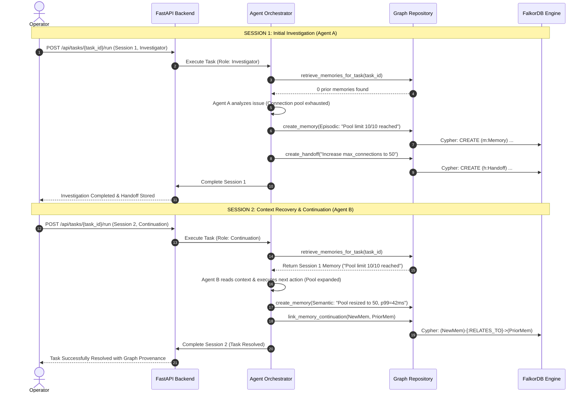
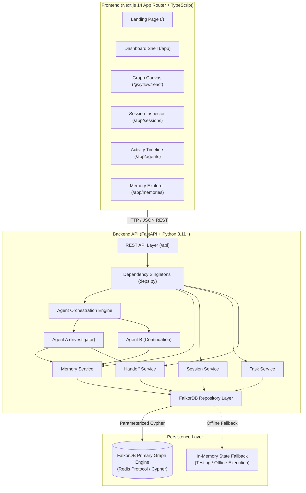

# ContinuumAI — Persistent Memory & Multi-Agent Coordination

<p align="center">
  
  
  
  
  
</p>

<p align="center">
  <strong>Give AI agents continuity across sessions.</strong><br />
  A graph-powered memory and coordination layer structuring agent experiences, operational findings, task states, and multi-agent handoffs into a persistent knowledge graph.
</p>

<p align="center">
  <a href="https://github.com/Halanaaz1401/ContinuumAI">📦 GitHub Repository</a> •
  <a href="#-system-architecture">🏗️ Architecture</a> •
  <a href="#-graph-data-model">🕸️ Graph Model</a> •
  <a href="#-installation--quickstart">🚀 Quickstart</a> •
  <a href="#-table-of-contents">📖 Documentation</a>
</p>

<p align="center">
  <strong>Engineered by Hala Naaz</strong>
</p>

---


## Table of Contents

- [Problem Statement](#problem-statement)
- [Proposed Solution](#proposed-solution)
- [Core Features & Status](#core-features--status)
- [Product Workflow](#product-workflow)
- [System Architecture](#system-architecture)
- [Graph Data Model](#graph-data-model)
- [Graph Relationships & Cypher Queries](#graph-relationships--cypher-queries)
- [Technology Stack](#technology-stack)
- [Repository Structure](#repository-structure)
- [Prerequisites](#prerequisites)
- [Local Installation & Setup](#local-installation--setup)
- [Environment Variables](#environment-variables)
- [Running the Backend](#running-the-backend)
- [Running the Frontend](#running-the-frontend)
- [Running Tests](#running-tests)
- [FalkorDB Setup & Connection](#falkordb-setup--connection)
- [Current Limitations & Known Issues](#current-limitations--known-issues)
- [Roadmap](#roadmap)
- [Security & Configuration](#security--configuration)
- [Contributing](#contributing)
- [License](#license)
- [Maintainer](#maintainer)

---

## Problem Statement

Modern multi-agent AI architectures encounter persistent operational context loss:

1. **Session Discontinuity:** When an agent's execution session terminates, its conversational scratchpad and working memory vanish. Future sessions start cold from zero.
2. **Redundant Investigations:** Agents duplicate expensive API calls, diagnostic routines, and database explorations because discoveries are not queryable across agent runs.
3. **Fragmented Context:** Operational findings, system anomalies, and decisions are buried in unstructured conversational transcripts rather than linked domain entities.
4. **Weak Handoffs:** Tasks transitioning from one agent role (e.g., Triage / Investigator) to another (e.g., Remediation / Developer) lack formal contracts, rationale, and clear next steps.

---

## Proposed Solution

ContinuumAI addresses these problems by decoupling agent memory from ephemeral sessions and storing it in a persistent, queryable knowledge graph powered by **FalkorDB**.

* **Categorized Memory:** Structures memory into *Episodic* (actions and events), *Semantic* (facts and system discoveries), and *Procedural* (reusable strategies).
* **Provenance Tracking:** Every memory record captures its authoring agent, originating session, associated task, and timestamps.
* **Structured Handoff Contracts:** Explicit handoff entities formalize the state transfer between agents with summaries and concrete next actions.
* **Graph Observability:** Real-time visual canvas powered by React Flow mapping relationships between workspaces, tasks, agents, sessions, and memories.

---

## Core Features & Status

| Feature | Description | Implementation Status |
| :--- | :--- | :--- |
| **Workspace Scoping & Isolation** | Strict tenant isolation via `workspace_id` parameters across all service and repository layers. | **Implemented & Tested (In-Memory)** |
| **Cross-Route Dependency Singletons** | Centralized dependency injection providers in FastAPI (`deps.py`) ensuring shared service state. | **Implemented & Tested** |
| **Agent Orchestration Engine** | Coordinates Agent A (Investigator / Producer) and Agent B (Continuation / Consumer) execution. | **Implemented & Tested (In-Memory)** |
| **Memory Creation & Retrieval API** | REST endpoints (`/api/memories`) to filter, retrieve, and store structured agent memories. | **Implemented & Tested** |
| **Session & Task Lifecycle APIs** | REST endpoints (`/api/sessions`, `/api/tasks`) tracking session status and task states. | **Implemented & Tested (In-Memory)** |
| **Interactive Graph Visualizer** | React Flow canvas (`/app/graph`) with custom node renderers for memories, sessions, and agents. | **Implemented (Frontend Verified)** |
| **Timeline & Activity Log** | Audit log (`/app/agents`) tracking task assignment, memory retrieval, writes, and handoffs. | **Implemented (Frontend Verified)** |
| **Parameterized Cypher Layer** | Query definitions in `queries.py` utilizing Cypher parameters for index and node management. | **Implemented (Awaiting Live DB Verification)** |
| **Live FalkorDB Persistence** | Real-time persistence and query execution against a remote or local FalkorDB instance. | **Partially Implemented (Fallback Active)** |
| **Evidence & Decision First-Class Nodes** | Dedicated graph entities for supporting logs, query outputs, and architectural decisions. | **Planned** |
| **Live LLM Provider Adapters** | Direct streaming integration with Gemini / OpenAI APIs beyond deterministic test modes. | **Planned** |

---

## Product Workflow

The signature workflow demonstrates how two distinct agents preserve and consume knowledge across separate sessions:



---

## System Architecture



---

## Graph Data Model

The ContinuumAI schema models agent state and workflows as first-class graph entities:

```text
 (Workspace) ──[:HAS_AGENT]──► (Agent)
     │                           │
     ├──[:HAS_SESSION]──► (Session) ◄──[:PARTICIPATED_IN]──┘
     │                      │
     │                      ├──[:RECORDED]──► (Memory) ◄──[:CREATED]── (Agent)
     │                      │                   ▲
     │                      │                   │ [:RELATES_TO]
     │                      │                   │
     │                      ├──[:RECORDED]──► (Memory)
     │                      │
     │                      └──[:RECORDED]──► (Handoff)
     │                                          ▲
     └──[:HAS_TASK]─────► (Task) ───────────────┼──[:HAS_HANDOFF]
                            │                   │
                            └──[:HAS_MEMORY]────┘
```

### Entity Nodes

* **`Workspace`**: Represents an isolated tenant environment (`id`, `name`, `created_at`).
* **`Agent`**: Autonomous agent identity (`id`, `role`, `status`, `workspace_id`).
* **`Session`**: Bounded execution instance (`id`, `workspace_id`, `status`, `started_at`, `ended_at`).
* **`Task`**: Unit of work being investigated or resolved (`id`, `workspace_id`, `title`, `context`, `status`).
* **`Memory`**: Discrete knowledge finding (`id`, `workspace_id`, `memory_type`, `content`, `summary`, `status`, `created_at`).
* **`Handoff`**: Formal transition record between agents (`id`, `workspace_id`, `summary`, `next_action`, `created_at`).
* **`Decision` & `Evidence`**: *Planned for future iterations to represent supporting telemetry and architectural choices.*

---

## Graph Relationships & Cypher Queries

All graph queries are defined in `backend/app/graph/queries.py` and utilize strictly parameterized Cypher statements:

### 1. Schema Indexes
```cypher
CREATE INDEX FOR (w:Workspace) ON (w.id);
CREATE INDEX FOR (m:Memory) ON (m.id);
CREATE INDEX FOR (t:Task) ON (t.id);
CREATE INDEX FOR (s:Session) ON (s.id);
CREATE INDEX FOR (a:Agent) ON (a.id);
```

### 2. Creating a Provenance-Linked Memory
```cypher
MATCH (w:Workspace {id: $workspace_id})
MATCH (a:Agent {id: $agent_id})
MATCH (s:Session {id: $session_id})
MATCH (t:Task {id: $task_id})
CREATE (m:Memory {
    id: $memory_id,
    workspace_id: $workspace_id,
    memory_type: $memory_type,
    content: $content,
    summary: $summary,
    source_agent_id: $agent_id,
    source_session_id: $session_id,
    status: 'active',
    created_at: $created_at
})
CREATE (a)-[:CREATED]->(m)
CREATE (s)-[:RECORDED]->(m)
CREATE (t)-[:HAS_MEMORY]->(m)
RETURN m.id AS id;
```

### 3. Task Context Retrieval Across Sessions
```cypher
MATCH (w:Workspace {id: $workspace_id})-[:HAS_TASK]->(t:Task {id: $task_id})
MATCH (t)-[:HAS_MEMORY]->(m:Memory {status: 'active'})
RETURN m.id AS id,
       m.workspace_id AS workspace_id,
       m.memory_type AS memory_type,
       m.content AS content,
       m.summary AS summary,
       m.source_agent_id AS source_agent_id,
       m.source_session_id AS source_session_id,
       m.created_at AS created_at
ORDER BY m.created_at ASC;
```

### 4. Linking Knowledge Continuation
```cypher
MATCH (prior:Memory {id: $prior_memory_id})
MATCH (newMem:Memory {id: $new_memory_id})
CREATE (newMem)-[:RELATES_TO {relationship: 'continues_investigation'}]->(prior)
RETURN newMem.id AS source, prior.id AS target;
```

---

## Technology Stack

| Layer | Technology | Version | Purpose |
| :--- | :--- | :--- | :--- |
| **Backend API** | [FastAPI](https://fastapi.tiangolo.com/) | `>=0.110.0` | Asynchronous REST API framework and route validation. |
| **Web Server** | [Uvicorn](https://www.uvicorn.org/) | `>=0.28.0` | ASGI server running FastAPI application processes. |
| **Data Validation** | [Pydantic v2](https://docs.pydantic.dev/) | `>=2.6.0` | Strict data modeling and configuration management via `pydantic-settings`. |
| **Graph Database** | [FalkorDB](https://www.falkordb.com/) | Client `>=1.0.8` | Primary low-latency graph database engine supporting openCypher. |
| **Database Driver** | [redis-py](https://github.com/redis/redis-py) | `>=8.0.0` | Redis protocol transport layer used by the FalkorDB client. |
| **Testing** | [Pytest](https://pytest.org/) | `>=8.0.0` | Unit, route integration, and asynchronous test runner. |
| **Frontend App** | [Next.js](https://nextjs.org/) | `14.2.15` | React 18 App Router framework for static and dynamic rendering. |
| **Language** | [TypeScript](https://www.typescriptlang.org/) | `^5.4.3` | Type safety across client components and API client libraries. |
| **Styling** | [Tailwind CSS](https://tailwindcss.com/) | `^3.4.1` | Utility-first CSS framework adhering to the design token system. |
| **Graph Canvas** | [@xyflow/react](https://reactflow.dev/) | `^12.0.0` | Interactive node-and-edge visualizer rendering graph topology. |
| **Icons** | [Lucide React](https://lucide.dev/) | `^0.363.0` | Iconography for navigation, status badges, and actions. |

---

## Repository Structure

```text
ContinuumAI/
├── .env.example              # Environment variables template
├── .gitignore                # Git exclusions (secrets, caches, build files)
├── ARCHITECTURE.md           # System architecture specification
├── design.md                 # Design system tokens and UI specifications
├── docker-compose.yml        # Multi-container orchestration (FalkorDB + Backend + Frontend)
├── PRD.md                    # Product requirements document
├── README.md                 # Primary open-source project documentation
├── TASKS.md                  # Development checklist and implementation roadmap
│
├── backend/                  # FastAPI Application
│   ├── Dockerfile            # Container build definition for backend service
│   ├── requirements.txt      # Python dependencies
│   ├── app/
│   │   ├── main.py           # Application lifespan and CORS configuration
│   │   ├── agents/           # Agent orchestration engine (Agent A, Agent B)
│   │   ├── api/              # API router and modular endpoints (memories, sessions, etc.)
│   │   │   └── deps.py       # Shared singleton dependency injection providers
│   │   ├── core/             # Configuration (Pydantic Settings) and logging
│   │   ├── graph/            # FalkorDB connection, queries, and repository layer
│   │   ├── models/           # Pydantic schemas (Agent, Task, Session, Memory, Graph)
│   │   └── services/         # Domain services (Memory, Session, Task, Handoff)
│   └── tests/                # Test suite (isolation, cross-routes, orchestrator, FalkorDB)
│
├── frontend/                 # Next.js 14 Web Application
│   ├── Dockerfile            # Container build definition for frontend service
│   ├── package.json          # Node.js dependencies and build scripts
│   ├── tsconfig.json         # TypeScript configuration
│   ├── tailwind.config.js    # Tailwind styling tokens
│   ├── app/                  # Next.js App Router pages
│   │   ├── page.tsx          # Public product landing page
│   │   └── app/              # Application dashboard routes (graph, sessions, agents, etc.)
│   ├── components/           # UI components (graph nodes, timeline, drawers)
│   └── lib/                  # REST API client and TypeScript interface definitions
│
└── docs/                     # Technical specifications and API documentation
    ├── api-spec.md           # OpenAPI endpoint documentation
    ├── demo-script.md        # Reproducible demonstration walkthrough
    ├── graph-schema.md       # Cypher schema and index reference
    └── local-development.md  # Detailed setup guide
```

---

## Prerequisites

Before setting up ContinuumAI locally, ensure the following runtimes are installed:

* **Python:** Version `3.11`, `3.12`, or `3.13` (Python `3.14` pre-release is also supported by pure-Python wheels).
* **Node.js:** Version `18.x` or `20.x` LTS with `npm`.
* **Database:** Either an active instance of **FalkorDB Cloud** (free tier available) or a local Docker engine.

---

## Local Installation & Setup

### 1. Clone the Repository

```bash
git clone https://github.com/Halanaaz1401/ContinuumAI.git
cd ContinuumAI
```

### 2. Configure Environment Variables

Copy the template to create your local `.env` file:

```bash
# On Linux/macOS
cp .env.example .env

# On Windows PowerShell
Copy-Item .env.example .env
```

Open `.env` in an editor and configure your database endpoint and preferences.

---

## Environment Variables

The application relies on configuration values managed via Pydantic Settings in `backend/app/core/config.py`:

| Variable Name | Default Value | Description |
| :--- | :--- | :--- |
| `FALKORDB_HOST` | `localhost` | FalkorDB endpoint (or cloud hostname, e.g. `db-xxxx.falkordb.cloud`). |
| `FALKORDB_PORT` | `6379` | FalkorDB listening port. |
| `FALKORDB_USERNAME` | *(empty)* | Username for ACL authentication (typically `default` on cloud instances). |
| `FALKORDB_PASSWORD` | *(empty)* | Password or auth token for database authentication. |
| `FALKORDB_GRAPH_NAME` | `continuum_ai` | Target graph database key inside the FalkorDB instance. |
| `FALKORDB_SSL` | `false` | Set to `true` when connecting to SSL/TLS-enabled cloud instances. |
| `LLM_PROVIDER` | `mock` | Model adapter: `mock` (deterministic demo runner), `gemini`, or `openai`. |
| `LLM_API_KEY` | *(empty)* | Model provider API key (required only if `LLM_PROVIDER` is live). |
| `LLM_MODEL` | `gemini-1.5-flash` | Model identifier string. |
| `BACKEND_HOST` | `0.0.0.0` | Local bind address for the FastAPI backend. |
| `BACKEND_PORT` | `8000` | Local port for FastAPI. |
| `CORS_ORIGINS` | `http://localhost:3000` | Comma-separated list of allowed origins. |
| `NEXT_PUBLIC_API_BASE_URL` | `http://localhost:8000` | Backend URL used by client-side browser requests. |

---

## Running the Backend

### Using a Python Virtual Environment

```bash
# Navigate to backend directory or remain in root
cd backend

# Create and activate a virtual environment
python -m venv .venv

# On Linux/macOS
source .venv/bin/activate

# On Windows PowerShell
.\.venv\Scripts\Activate.ps1

# Install backend dependencies
pip install -r requirements.txt

# Start the FastAPI development server with auto-reload
uvicorn app.main:app --host 0.0.0.0 --port 8000 --reload
```

Once running:
* **Interactive OpenAPI Docs:** `http://localhost:8000/docs`
* **Health Check Endpoint:** `http://localhost:8000/api/health`

---

## Running the Frontend

```bash
# Navigate to frontend directory
cd frontend

# Install Node.js dependencies
npm install

# Start the Next.js development server
npm run dev
```

Open `http://localhost:3000` in your browser:
* **Public Landing Page:** `http://localhost:3000/`
* **Graph Canvas & Activity Dashboard:** `http://localhost:3000/app`

---

## Running Tests

### Backend Unit & Integration Tests

The test suite validates data models, memory services, workspace isolation, dependency injection, and cross-session orchestration workflows:

```bash
# Run all unit and mock tests from the root directory
pytest backend/tests

# Run specifically with verbose output
pytest -v backend/tests
```

*Note: `backend/tests/test_falkordb_integration.py` requires an active FalkorDB instance and will automatically skip if the host is unreachable.*

### Frontend Type Verification

```bash
cd frontend
npm run type-check
```

---

## FalkorDB Setup & Connection

ContinuumAI is architected to use **FalkorDB** as its primary graph engine.

### Option A: Local Instance via Docker
```bash
docker run -p 6379:6379 -it --rm falkordb/falkordb:latest
```

### Option B: FalkorDB Cloud
1. Create a free instance on [app.falkordb.cloud](https://app.falkordb.cloud/).
2. Obtain the host endpoint, assigned port, and password from the **Connectivity** tab.
3. Update `.env`:
   ```dotenv
   FALKORDB_HOST=db-your-instance.falkordb.cloud
   FALKORDB_PORT=6379
   FALKORDB_USERNAME=default
   FALKORDB_PASSWORD=your_cloud_password
   FALKORDB_GRAPH_NAME=continuum_ai
   FALKORDB_SSL=true
   ```

### Current Connection Mechanism
In the current code baseline:
* [backend/app/graph/connection.py](file:///c:/Users/Hala/Downloads/Project%20Files/ContinuumAI/backend/app/graph/connection.py) attempts to connect using the official `falkordb` Python library.
* If the package is not installed or the database is offline, the backend logs a warning and enters an **in-memory fallback mode**.
* In fallback mode, nodes and edges are stored in internal memory dictionaries (`_in_memory_nodes`), allowing the UI and mock orchestration tests to run without crashing.

---

## Current Limitations & Known Issues

1. **In-Memory Fallback Active by Default:** If FalkorDB is offline or the driver cannot connect, the backend silently falls back to in-memory dictionaries. Persistence across server restarts requires an active database connection.
2. **Graph Visualizer Serialization:** The current implementation of `get_workspace_graph()` in `repository.py` serializes nodes and edges directly from `_in_memory_nodes`. Live Cypher serialization for visualization (`GET_WORKSPACE_GRAPH`) is implemented as a query definition but awaits direct binding in the live database path.
3. **Task & Session Persistence in Cypher:** While `CREATE_SESSION` and `CREATE_TASK` Cypher queries are defined in `queries.py`, `SessionService` and `TaskService` currently maintain lifecycle states in process memory. Full dual-write persistence to the graph is in active development.
4. **Deterministic Agent Mode:** Agent A and Agent B currently run deterministic diagnostic logic ("investigation of connection pool exhaustion") designed for consistent demonstrations. Live LLM API integration via external providers (Gemini / OpenAI) is defined in architecture but unlinked.
5. **Frontend Lint Configuration:** Next.js linting requires an explicit `.eslintrc.json` configuration file, currently omitted to avoid interactive prompts during builds.

---

## Roadmap

- [ ] **Phase 1: Real-Time Graph Persistence**
  - Bind `SessionService` and `TaskService` directly to FalkorDB `CREATE` and `MATCH` queries.
  - Implement full Cypher-backed node and edge serialization in `get_workspace_graph()`.
  - Introduce explicit visual badges on the frontend indicating real graph storage vs. fallback mode.
- [ ] **Phase 2: First-Class Evidence & Decision Entities**
  - Add `Evidence` and `Decision` nodes linked to `Task` and `Memory` via `SUPPORTS` and `BASED_ON` relationships.
  - Expand the React Flow drawer to display cryptographic checksums and logs.
- [ ] **Phase 3: Multi-Provider LLM Integration**
  - Implement dynamic prompt synthesis feeding historical graph context into Gemini 1.5 Flash and OpenAI GPT-4o.
  - Support automatic episodic memory extraction from raw multi-turn agent conversations.
- [ ] **Phase 4: Advanced GraphRAG & Hybrid Search**
  - Introduce vector embeddings alongside graph topologies for semantic similarity search over stored episodic memories.

---

## Security & Configuration

* **Credential Management:** Never commit `.env` or any file containing passwords or API keys. Verify that `.env` is listed in `.gitignore`.
* **Tenant Isolation:** All graph operations must explicitly supply `workspace_id`. Cross-tenant queries are blocked at both the API route and Cypher query levels.
* **Cypher Injection Mitigation:** All Cypher operations must use parameterized queries (`$parameter_name`) with dictionary parameters. Raw string formatting or concatenation in Cypher statements is strictly prohibited.

---

## Contributing

Contributions to ContinuumAI are welcome! Please follow these guidelines:

1. Fork the repository and create a feature branch (`git checkout -b feature/amazing-feature`).
2. Adhere to strict type hints in Python (`typing`, Pydantic models) and TypeScript.
3. Ensure all backend tests pass before opening a Pull Request (`pytest backend/tests`).
4. Keep Cypher queries strictly parameterized and documented in `queries.py`.
5. Open a Pull Request with a clear description of the problem solved.

---

## License

Licensing has not yet been specified for this project. All rights are currently reserved by the maintainer. An open-source license (such as Apache 2.0 or MIT) will be designated in a future release.

---

## Maintainer

Maintained and developed by **[@Halanaaz1401](https://github.com/Halanaaz1401)**.  
Repository: [https://github.com/Halanaaz1401/ContinuumAI](https://github.com/Halanaaz1401/ContinuumAI)
