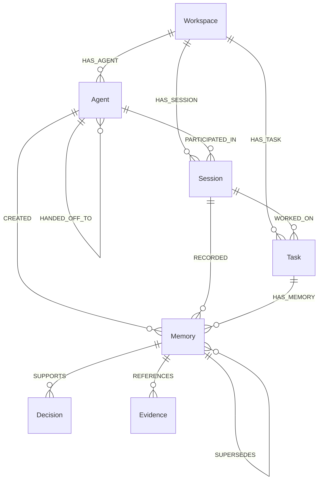

# ContinuumAI — FalkorDB Graph Schema & Cypher Specification

> **Status:** Proposed Specification (*Cypher queries are marked as [UNTESTED SPECIFICATION] pending backend execution against a live FalkorDB instance during hackathon implementation*).  
> **Source of Truth:** [`PRD.md`](file:///c:/Users/Hala/Downloads/Project%20Files/ContinuumAI/PRD.md#L386-L428).

---

## 1. Graph Data Model Overview

ContinuumAI models agent memory, tasks, and collaboration as a connected property graph inside **FalkorDB**. The schema is designed to provide verifiable provenance, strict workspace isolation, and fast relationship traversals.



---

## 2. Node Labels & Properties

### 2.1 `:Workspace`
Top-level multi-tenant isolation anchor. All graph queries must trace back to a workspace.
- `id` *(string, unique index)*: Workspace identifier (e.g. `"ws-default"`, `"demo-workspace-01"`).
- `name` *(string)*: Display name.
- `created_at` *(string, ISO 8601)*: Creation timestamp.

### 2.2 `:Agent`
Represents an AI agent entity or role.
- `id` *(string, unique index)*: Agent identifier (e.g. `"agent-a-investigator"`, `"agent-b-continuation"`).
- `workspace_id` *(string)*: Associated workspace.
- `role` *(string)*: Agent responsibility (e.g. `"Investigator"`, `"Continuation"`, `"Coordinator"`).
- `status` *(string)*: `"idle"`, `"running"`, `"completed"`.

### 2.3 `:Session`
An execution boundary or conversation run.
- `id` *(string, unique index)*: Session identifier (e.g. `"sess-001"`, `"sess-002"`).
- `workspace_id` *(string)*: Associated workspace.
- `status` *(string)*: `"active"`, `"completed"`, `"paused"`.
- `started_at` *(string, ISO 8601)*: Start timestamp.
- `ended_at` *(string, ISO 8601, optional)*: Completion timestamp.

### 2.4 `:Task`
An objective assigned to one or more agents across sessions.
- `id` *(string, unique index)*: Task identifier (e.g. `"task-101"`).
- `workspace_id` *(string)*: Associated workspace.
- `title` *(string)*: Brief objective description.
- `status` *(string)*: `"pending"`, `"in_progress"`, `"resolved"`.
- `created_at` *(string, ISO 8601)*: Creation timestamp.

### 2.5 `:Memory`
A discrete piece of retained knowledge.
- `id` *(string, unique index)*: Memory identifier (e.g. `"mem-001"`).
- `workspace_id` *(string)*: Associated workspace.
- `memory_type` *(string)*: `"episodic"`, `"semantic"`, or `"procedural"`.
- `content` *(string)*: Full text of the finding, fact, or procedure.
- `summary` *(string, optional)*: Short synopsis.
- `source_agent_id` *(string)*: Author agent ID.
- `source_session_id` *(string)*: Author session ID.
- `status` *(string)*: `"active"` or `"superseded"`.
- `created_at` *(string, ISO 8601)*: Creation timestamp.

### 2.6 `:Decision`
A conclusion or choice made based on accumulated memories.
- `id` *(string)*: Decision identifier.
- `decision` *(string)*: Text of the decision made.
- `rationale` *(string)*: Reason for the decision.
- `created_at` *(string, ISO 8601)*: Timestamp.

### 2.7 `:Evidence`
Supporting artifacts, error logs, or metrics validating a memory.
- `id` *(string)*: Evidence identifier.
- `evidence_type` *(string)*: `"log"`, `"metric"`, `"stacktrace"`, `"api_response"`.
- `payload` *(string)*: Raw evidence text or snippet.

### 2.8 `:Handoff`
An explicit coordination entity bridging two agents/sessions.
- `id` *(string)*: Handoff identifier.
- `summary` *(string)*: Summary of progress so far.
- `next_action` *(string)*: Concrete instruction for successor agent.
- `created_at` *(string, ISO 8601)*: Timestamp.

---

## 3. Relationship Types & Directions

| Relationship | Direction | Description |
| :--- | :--- | :--- |
| `HAS_AGENT` | `(Workspace)-[:HAS_AGENT]->(Agent)` | Workspace owns agent entity |
| `HAS_SESSION` | `(Workspace)-[:HAS_SESSION]->(Session)` | Workspace owns session |
| `HAS_TASK` | `(Workspace)-[:HAS_TASK]->(Task)` | Workspace owns task |
| `PARTICIPATED_IN` | `(Agent)-[:PARTICIPATED_IN]->(Session)` | Agent operated in session |
| `WORKED_ON` | `(Session)-[:WORKED_ON]->(Task)` | Session addressed task |
| `CREATED` | `(Agent)-[:CREATED]->(Memory)` | Agent authored memory |
| `RECORDED` | `(Session)-[:RECORDED]->(Memory)` | Session captured memory |
| `HAS_MEMORY` | `(Task)-[:HAS_MEMORY]->(Memory)` | Memory relates to task |
| `RELATES_TO` | `(Memory)-[:RELATES_TO]->(Memory)` | Associative memory link |
| `SUPERSEDES` | `(Memory)-[:SUPERSEDES]->(Memory)` | Newer finding replaces older finding |
| `SUPPORTS` | `(Memory)-[:SUPPORTS]->(Decision)` | Memory justifies decision |
| `REFERENCES` | `(Memory)-[:REFERENCES]->(Evidence)` | Memory links to proof |
| `HANDED_OFF_TO` | `(Agent)-[:HANDED_OFF_TO]->(Agent)` | Task transition between agents |

---

## 4. Parameterized Cypher Queries

> **Notice:** The queries below use standard Cypher syntax compatible with FalkorDB openCypher. They are marked **[UNTESTED SPECIFICATION]** until executed against the live database in Phase 1.

### 4.1 Create Node Constraints / Indexes
```cypher
// [UNTESTED SPECIFICATION]
CREATE INDEX FOR (w:Workspace) ON (w.id);
CREATE INDEX FOR (m:Memory) ON (m.id);
CREATE INDEX FOR (t:Task) ON (t.id);
CREATE INDEX FOR (s:Session) ON (s.id);
CREATE INDEX FOR (a:Agent) ON (a.id);
```

### 4.2 Record Memory in Session 1 (Agent A)
```cypher
// [UNTESTED SPECIFICATION]
// Parameters: $workspace_id, $agent_id, $session_id, $task_id, $memory_id, $content, $type, $created_at
MATCH (w:Workspace {id: $workspace_id})
MATCH (a:Agent {id: $agent_id})
MATCH (s:Session {id: $session_id})
MATCH (t:Task {id: $task_id})
CREATE (m:Memory {
    id: $memory_id,
    workspace_id: $workspace_id,
    memory_type: $type,
    content: $content,
    source_agent_id: $agent_id,
    source_session_id: $session_id,
    status: 'active',
    created_at: $created_at
})
CREATE (a)-[:CREATED]->(m)
CREATE (s)-[:RECORDED]->(m)
CREATE (t)-[:HAS_MEMORY]->(m)
RETURN m.id AS memory_id, m.created_at AS created_at
```

### 4.3 Record Agent Handoff
```cypher
// [UNTESTED SPECIFICATION]
// Parameters: $handoff_id, $source_agent_id, $target_agent_id, $session_id, $task_id, $summary, $next_action, $created_at
MATCH (src:Agent {id: $source_agent_id})
MATCH (tgt:Agent {id: $target_agent_id})
MATCH (s:Session {id: $session_id})
MATCH (t:Task {id: $task_id})
CREATE (h:Handoff {
    id: $handoff_id,
    summary: $summary,
    next_action: $next_action,
    created_at: $created_at
})
CREATE (src)-[:HANDED_OFF_TO]->(tgt)
CREATE (s)-[:RECORDED]->(h)
CREATE (t)-[:HAS_HANDOFF]->(h)
RETURN h.id AS handoff_id
```

### 4.4 Retrieve Memories for Session 2 (Agent B)
```cypher
// [UNTESTED SPECIFICATION]
// Parameters: $workspace_id, $task_id
MATCH (w:Workspace {id: $workspace_id})-[:HAS_TASK]->(t:Task {id: $task_id})
MATCH (t)-[:HAS_MEMORY]->(m:Memory {status: 'active'})
MATCH (a:Agent)-[:CREATED]->(m)
MATCH (s:Session)-[:RECORDED]->(m)
RETURN m.id AS id,
       m.memory_type AS type,
       m.content AS content,
       m.created_at AS created_at,
       a.id AS author_agent,
       s.id AS originating_session
ORDER BY m.created_at ASC
```

### 4.5 Link New Memory to Prior Memory (Continuation)
```cypher
// [UNTESTED SPECIFICATION]
// Parameters: $new_memory_id, $prior_memory_id
MATCH (prior:Memory {id: $prior_memory_id})
MATCH (newMem:Memory {id: $new_memory_id})
CREATE (newMem)-[:RELATES_TO {relationship: 'continues_investigation'}]->(prior)
RETURN newMem.id, prior.id
```

### 4.6 List Workspace Graph (for Visualizer Canvas)
```cypher
// [UNTESTED SPECIFICATION]
// Parameters: $workspace_id
MATCH (w:Workspace {id: $workspace_id})-[r]->(n)
RETURN w, r, n
UNION
MATCH (w:Workspace {id: $workspace_id})-[:HAS_TASK]->(t:Task)-[r]->(m:Memory)
RETURN t AS source, r, m AS target
```
